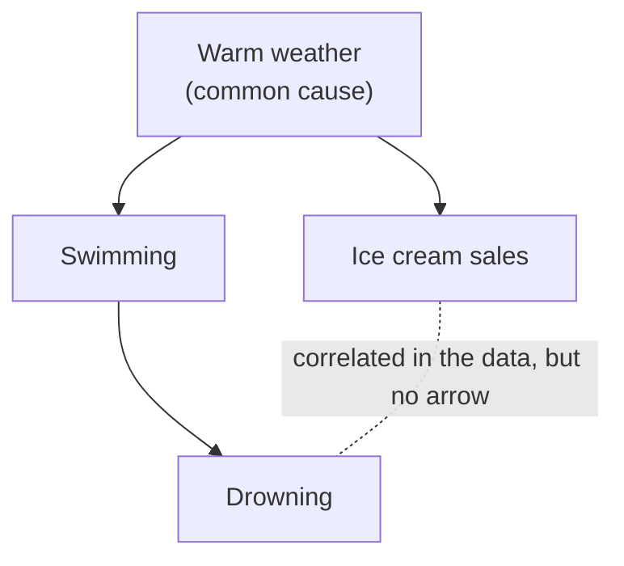

# PearlDoCalculus explained for a 15-year-old

A plain-language overview of what this project proves, why it starts with DAGs,
and how the code is organised. For the technical handover, see `HANDOFF.md`.

## What is this about?

PearlDoCalculus is a computer program that proves rules for when we can say that
something *causes* something else, and not just that two things go together.
The rules come from the computer scientist Judea Pearl. We have written them
into a proof program (Lean) and let the machine check every single step.

**Correlation is not causation.** In summer, more ice cream is sold and more
people drown. Ice cream and drowning go together, but ice cream kills no one.
Both come from a third thing: warm weather. Warm weather makes people buy ice
cream *and* go swimming.

The warm weather is called a **common cause** (in technical terms a
*confounder*). It creates a connection without one thing affecting the other.

**Seeing is not the same as doing.** If you *see* someone buying ice cream, it
is probably warm, and then more people are swimming. If you *decide* that
everyone gets free ice cream on a cold November day, you do not change the
weather. More people will not drown.

Pearl writes doing something as do(…). "P(drowning | do(ice cream))" means: how
many drown if we *force* ice cream to happen, not just see people buying it.

The whole project is about one question: **When can we work out what happens if
we do something, just by looking at data where nobody did anything?** Sometimes
it is possible, sometimes it is not. We have proved the rules that tell the two
cases apart.

## Why we started with DAGs

We started with DAGs because everything else in Pearl's theory rests on them.
Before you can prove anything about causes, you must be able to write down
*what affects what*. A DAG is exactly that.

DAG stands for *directed acyclic graph*: a directed graph without cycles. It is
a drawing with dots and arrows:

- **The dots** are things that can be measured: weather, ice cream sales,
  swimming, drowning.
- **The arrows** mean "directly affects". Weather → ice cream sales means the
  weather affects how much ice cream is sold.
- **No cycles**: if you follow the arrows, you never get back to where you
  started. Nothing can be its own cause.

The ice cream example looks like this: weather → ice cream sales,
weather → swimming → drowning. There is no arrow from ice cream sales to
drowning. The drawing shows at once why the connection is misleading: the only
link runs *backwards* through the weather.

The arrows show what affects what. The dotted line is the correlation we see in
the data, but there is no arrow between ice cream sales and drowning.

**Hidden causes.** Some dots cannot be measured, for example genes or how
someone was feeling that day. They are called **latent**. They are in the
drawing even though we have no data about them, and they are what makes the
subject hard.

We started with DAGs for three reasons:

1. **It is the foundation.** d-separation, the do-calculus and identification
   are all about paths in a DAG. Without a precise DAG there is nothing to
   prove.
2. **It is easy for a computer.** A finite graph is just a list of dots and
   arrows. Lean can compute with it directly.
3. **No cycles gives an order.** Because the arrows never go round in a circle,
   the dots can be ordered from "first" to "last". Then the probability of the
   whole system can be built up one dot at a time. That trick is used in almost
   every proof.

The very first file in the project, `DAG.lean`, is only 66 lines. Everything
else, over 21 000 lines, builds on it.

## What a proof in Lean is

Lean is a programming language in which a program is a mathematical proof. The
machine accepts it only if every single step is correct. It skips nothing as
"obvious", the way we do on the blackboard.

Think of it as an extremely strict maths teacher. It gives either full marks or
zero. It accepts no "this is easy to see". It never gets tired.

Two things make this valuable:

- **Proofs in research papers can contain mistakes.** Even well-known papers
  have had gaps that nobody noticed for years. Once Lean has accepted a proof,
  the gap is gone. That holds even when the proof was written with help from an
  AI, as this one was.
- **You can check that nobody cheated.** Lean has a word, `sorry`, which means
  "I am skipping this". The project has zero `sorry`. Every main result uses
  only the three standard axioms that all modern mathematics is built on.

**But one thing Lean cannot check:** whether we wrote down the right
*question*. If the definition of "identifiable" is wrong, we prove true things
about the wrong concept.

That is why the project has test examples: small graphs where we know the
answer in advance and check that the definitions give it. It is also why an
expert should look over the definitions one day.

## What we have proved, step by step

We have proved six steps of a staircase. Each step stands on the one before.

1. **d-separation: reading independence off the drawing.** Sometimes you can
   see from a DAG that two things have nothing to do with each other once you
   know a third. The rule for this is called d-separation. We have proved that
   the rule is *sound*: if the drawing says "independent", it is true in every
   single model that fits the drawing. We have also proved that it is
   *complete*: if the drawing says "not independent", there is a model where
   they really are connected. So the rule is exactly right, not just a rule of
   thumb.
2. **The three rules of the do-calculus.** Pearl has three rules for moving and
   removing do(…) in a formula. We have proved all three. We have also proved
   that each rule is *exact*: when the condition of the rule does not hold,
   there is a counterexample. The last part of rule 3 was the hardest thing in
   the whole first half of the project.
3. **Adjustment formulas.** Two ready-made recipes for working out the effect
   of an intervention from ordinary data: *back-door*, where you compare similar
   groups (for example the same weather), and *front-door*, where you go via an
   intermediate step. Both are proved under Pearl's own conditions.
4. **Identification with hidden causes.** An effect is *identifiable* if it can
   be worked out from data about what we can measure, no matter what the hidden
   causes do. We have proved when this is possible, using Tian's c-components:
   groups of dots that share hidden causes. We have also proved when it is
   *not* possible. The simplest example is "the bow": x affects y, and a hidden
   cause affects both. Then no amount of data can tell the two apart. We prove
   this by building two worlds that give exactly the same data but different
   answers.
5. **The ID algorithm as a check the machine can run.** Shpitser and Pearl made
   an algorithm, ID, that decides whether an effect is identifiable. We have
   written it as a program, `idCheck`, and proved that when the program says
   yes, the answer is yes. On a concrete graph, Lean can simply *compute* the
   answer. We have also proved the version for conditional questions (IDC) and
   the Verma constraint, a well-known example of data having hidden patterns.
6. **When ID says no: the hedge.** We have proved that when `idCheck` says no,
   there is a *hedge*. That is a particular pattern of two overlapping regions
   of the graph, stitched together by hidden causes. The last piece, that a
   hedge always makes the effect impossible to work out, is only partly done
   (see the last section).

Together this covers about half of what you could call "Pearl's identification
theory, formalised". That half is done thoroughly.

## How the code is organised

The code is built like a house with floors: each file uses only what lies below
it. That way you can understand and check one floor at a time.

**The floors, from the bottom up:**

1. **The graph** (`DAG`, `Reachability`, `Walks`): dots, arrows, paths.
2. **The model** (`CausalModel`): probabilities on the graph.
3. **d-separation** (`DSeparation`, `DSepSound`, `Completeness`): reading
   independence off the drawing.
4. **Interventions and the do-calculus** (`DoCalculus`, `Rule3Flag`): what
   happens when we do something.
5. **Adjustment** (`Adjustment`): back-door and front-door.
6. **Identification** (`Identification`, `IdAlgo`, `Idc`, `Hedge`): hidden
   causes, the ID algorithm and the hedge.

**The ideas that make the code elegant:**

- **One building block for probability.** Each dot gets a small "die" that says
  how it behaves given its parents. The probability of everything together is
  just the product of all the dice. The rest of the project is built on that
  one idea.
- **An intervention is swapping a die.** Doing do(x) means the dot x gets a
  trick die that always shows the value we chose and ignores its parents. That
  is one definition, `doModel`, and it is used everywhere. You do not need
  separate rules for each situation.
- **Compare the dice, not the whole worlds.** To show that two models give the
  same answer, we compare them die by die. That avoids a lot of heavy
  calculation, and a known technical problem in Lean with saying that two
  things of different types are "equal".
- **Relabelling instead of calculating.** To show that two worlds give the same
  data, we show that the hidden coins in one can be relabelled as the coins in
  the other. Then the data must be the same, without adding up a single
  probability.
- **Prove the small pattern once, lift it to everything.** A helper result
  (`not_ident_of_sub`) says that more arrows never make anything easier to work
  out. So when a small pattern is impossible, every larger graph that contains
  it is impossible too.
- **A program that proves it is right.** `idCheck` is both something the
  computer can run and a proof. If it answers yes, the effect is proved
  identifiable. On a concrete graph you just write `decide`, and Lean works it
  out.
- **Tests next to the proofs.** Separate files (`Audit`, `DoAudit`, `IdAudit`)
  check small examples where the answer is known. There we catch definitions
  that are proved correct but are about the wrong thing.

We also had a fixed way of working. We wrote the argument on "paper" first,
then the statement with `sorry`, then the proof. Changes were made by small
scripts that refuse to run if the text they are meant to change is not there.
A new version was only published when the whole project built cleanly.

## What is not elegant

It would be wrong to say that all the code is elegant. The ideas above apply to
the core. Around it there is clutter that a tidy programmer would remove:

- **One giant file.** `Identification.lean` is about 8 300 lines. It grew one
  round at a time and should have been split into many small files.
- **Repetition.** Small helper functions are written several times in
  different places. One trick for splitting up the hidden variables exists in
  three almost identical versions.
- **"Try everything" code.** In many places the code in effect says "try A,
  otherwise B, otherwise C". That is because we could not check in advance
  which wording the library would accept. It works, but it is not pretty.
- **Old solutions made redundant.** Some early results were later proved more
  generally, but the old ones are still there.
- **Mistakes along the way.** Version 4.37 was published without building. The
  cause was a small code error and a safety check that read an old log. It was
  fixed in 4.38, and the way of working has been tightened.

None of this makes the proofs any less correct. Lean has checked everything.
But it makes the code harder to read for whoever continues.

## What remains

The big thing that remains is to prove that the ID algorithm is *complete*:
when it says no, it really is impossible to work out the answer. We have proved
that a no always gives a hedge. What is missing is building the two worlds that
show that every hedge is impossible.

The recipe is in the paper by Shpitser and Pearl (2008). It uses only coins
showing 0 or 1, and dots that count whether the number of ones is even or odd.
The plan is written out step by step in `HANDOFF.md`, so that someone else can
carry on.

## Glossary

| Word | Means |
| --- | --- |
| DAG | A drawing with dots and arrows and no cycles |
| Latent | A hidden cause we have no data about |
| Confounder | A common cause that creates a misleading correlation |
| do(x) | *Doing* x, as opposed to seeing x |
| d-separation | A rule for reading independence off the drawing |
| Identifiable | Can be worked out from data about what we can measure |
| C-component | A group of dots that share hidden causes |
| Hedge | A pattern in the graph that makes an effect impossible to work out |
| Lean | A programming language where programs are proofs the machine checks |
| `sorry` | Lean's word for "I am skipping this"; the project has none |

Written November 2026, for version 4.38.
